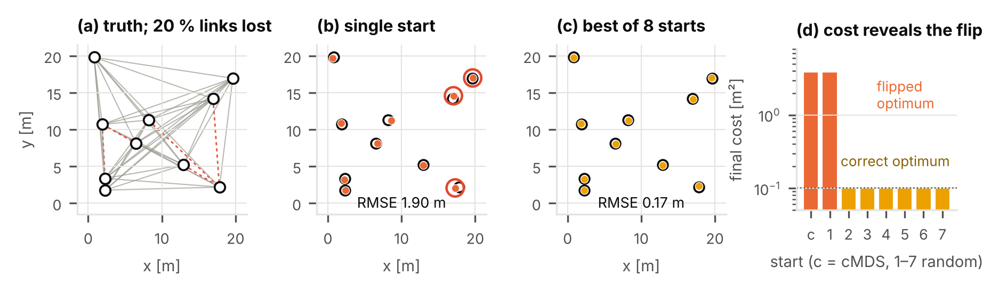

# Range-only 3D anchor self-localization for UWB

Comparison of algorithms that estimate the 3D positions of UWB anchors from their pairwise
two-way ranges alone. Six variants of four algorithm families are evaluated in Monte Carlo
simulation against the Cramér–Rao bound (CRB) under range noise, missing links, NLOS bias
and different anchor height spreads.

The full write-up is in [`paper/main.pdf`](paper/main.pdf) (5 pages, two columns).



*A single-start NLS run converges to a flipped configuration (b). Among eight starts, the lowest
final cost picks the correct one (c, d).*

## Main results

| Setting | Result |
|---|---|
| Clean data, σ = 10 cm, N = 8 | NLS/LM from a cMDS start reaches the CRB (17.0 cm vs. 16.2 cm median RMSE) |
| 20 % missing links, N = 12 | Gross failures (RMSE > 1 m): 30 % single start, 3 % multi-start |
| 5–10 % NLOS links | Soft-ℓ₁ loss lowers the median error by 27–33 % |
| Height spread ≤ 2 m | Vertical error is 5–6× the horizontal error |
| Covariance σ²(JᵀJ)⁺ | 95 % ellipse covers 94 % of 400 Monte Carlo estimates |

Recommended pipeline: check link count and rigidity, initialize with classical MDS,
refine with robust (soft-ℓ₁) Levenberg–Marquardt from several starts, and fix the absolute frame
by a Procrustes fit onto at least three surveyed points.

## Methods

| Estimator | Idea |
|---|---|
| cMDS | classical multidimensional scaling, missing ranges filled by shortest paths |
| SMACOF | weighted stress majorization |
| NLS/LM | nonlinear least squares (Levenberg–Marquardt) over all measured ranges |
| NLS/LM multi-start (+ soft-ℓ₁) | eight starts (cMDS + seven random), lowest cost kept, optional robust loss |
| SDP | semidefinite relaxation, offline reference |

## Repository layout

```
paper/      LaTeX source (main.tex, refs.tex), figures and the compiled PDF
src/        simulation core, experiments and figure generation
results/    stored simulation output used by the figures
```

| File | Purpose |
|---|---|
| `src/sim_core.py` | layout and range simulation, estimators, error metrics, CRB |
| `src/experiments.py` | sweeps over noise, anchor count, link loss, NLOS and height → `results/results.json` |
| `src/grid_scatter.py` | failure-rate grid (N × link loss) and covariance check → `results/grid_scatter.json` |
| `src/failure_case.py` | finds one mesh where single-start fails and multi-start succeeds → `results/failure_case.json` |
| `src/make_figures.py` | regenerates every figure in `paper/figures/` from the stored results |

## Reproduce

```bash
python3 -m venv .venv && source .venv/bin/activate
pip install -r requirements.txt

# figures only, from the stored results (seconds)
python src/make_figures.py

# full simulations (several minutes to tens of minutes, depending on the number of cores)
python src/experiments.py
python src/grid_scatter.py
python src/failure_case.py
python src/make_figures.py

# paper
cd paper && pdflatex main.tex && pdflatex main.tex
```

Quick smoke test with few trials, written to a temporary folder:

```bash
python src/experiments.py --trials 2 --out /tmp/uwb_test
python src/grid_scatter.py --trials 2 --scatter 10 --out /tmp/uwb_test
```

All random draws are seeded, so reruns reproduce the stored results (runtimes depend on the machine).

## Limitations

- Simulation only: Gaussian range noise and uniform positive NLOS bias, no antenna-delay errors.
- Anchors are drawn uniformly in a 20 × 20 × 6 m volume, not from a specific site layout.
- Runtimes were measured on a desktop CPU in Python and are indicative only.
- Height priors and a changing anchor count were not simulated.

